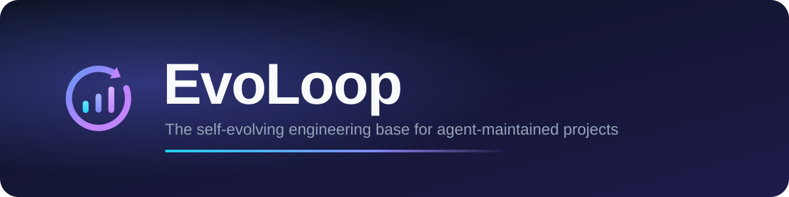

<p align="center">
  
</p>

<p align="center">
  <strong>English</strong> · <a href="README.md">简体中文</a>
</p>

<p align="center">
  
  
  
  
</p>

---

> [!WARNING]
> **For evaluation, learning and research only. Do not point it at production and walk away.**
>
> EvoLoop constrains agents **only through prompts — soft constraints in text**, with no permission isolation, sandbox, audit trail or runtime enforcement. An agent can still act beyond its brief, delete or overwrite files, leak credentials, merge changes that should not land, publish a bad release, or burn through API budget. Whether the rules are followed depends on the model, the prompt, the context and luck — **it is not a technical guarantee**. By using this project you accept those risks.

## What EvoLoop is

EvoLoop is an engineering base for projects whose code is **written, reviewed, merged and released by coding agents**, with a human keeping direction and taste. It is not an application. It is the operating system around the agents: a routing table, a set of non-negotiable invariants, a lessons ledger that turns repeated mistakes into standards, community and release gates, and three long-running autonomous loops.

> The problem it solves is not "can an agent write code?" It is **"will an agent fall into the same pit it was already pulled out of?"**

Three principles run through the repository:

- **Humans keep direction and taste; agents own execution and verification.** Product boundaries, aesthetics, security and the block list stay with the maintainer; everything else belongs to the loops.
- **Every rework becomes a rule**, not a reminder to "be more careful".
- **"Fixed" holds only on the reporter's real surface.** A compile is not a test, and a cross-build is not a run on that platform.

## Risks and limits

> **One sentence: these are soft constraints in prompts, not a security mechanism.**

- **The rules live in prompts and documents, not runtime enforcement.** There is no permission system, sandbox, audit trail or interlock. A model can ignore a rule, or reinterpret it into something else.
- **Agents still make mistakes.** Including — but not limited to — deleting or overwriting files, changing repository settings, writing credentials into logs or commits, merging a PR that should not land, publishing a broken release, or burning API budget.
- **Evaluation, learning and research only.** Not suitable for unattended production automation, especially where real user data, production credentials or irreversible actions are involved.
- **Behavior drifts with models and platforms.** The same prompt can behave differently across models, versions and clients. Working today does not mean working tomorrow.
- **No quality guarantee.** The project is provided "as is" under the MIT license, with no promise of fixes, safety or availability.

If you try it on a real project, add at least: **an isolated repository and credentials, least-privilege tokens, branch protection, a human review gate, rollback-capable backups and a cost cap**. Those hard controls are outside the scope of this project.

## How it works

### 1. Three autonomous loops

| Loop | Entrance | Responsibility | The human keeps |
| --- | --- | --- | --- |
| **Loop 1** | GitHub and community chat | Triage issues, review and merge community PRs, release, reply | Security gates, product direction |
| **Loop 2** | Social media | Filter mentions with a cheap model first, reproduce real feedback, fix, ship, reply | Tone, public crisis response |
| **Loop 3** | The codebase itself | Nightly review of the day's commits, lessons, cleanup, block-list proposals | The block-list decision |

Each loop owns one entrance and keeps its own checkpoint; the loops do not share a queue. When two loops can act on the same item, the item belongs to the loop that owns its entrance — the other loop links to it and does not act.

**Start with one loop. Add the next only when the first stops producing rework.** Running three at once usually means none of them has a clear entrance or owner.

### 2. A lessons ledger that evolves

```
Today's commits
    │
    ▼  Loop 3 — nightly review (three questions only)
    │   · What had to be fixed again?
    │   · What should not have merged?
    │   · What was verified too thinly?
    ▼
LESSONS.md ── one lesson = rule + reason + evidence + Seen N×
    │
    │  The same lesson seen on 3 separate days
    ▼
docs/code-standards.md ── promoted to a hard rule, checked by every review
```

`LESSONS.md` is not a diary. It is the project's long-term memory. **Every agent reads it before changing code**, so the next agent inherits the mistake instead of paying for it again. Without it, agents keep repeating the same failure; with it, a pit becomes a wall.

### 3. Verification gates grounded in reality

- Reproduce on the reporter's **OS, build, agent or client, and real data** before calling anything fixed.
- **A check that was not run is listed as not run.** Never omitted, never softened into "should be fine".
- **A fix reaches every sibling of the bug.** Grep for the same pattern before shipping.
- **A failed read, parse or hash means "unknown", never "empty".** Guards fail closed.
- **Project defaults never override a value the user set.** Read every place the setting is read before writing it.

## Quick start

EvoLoop ships as a **template**. Fork or copy it into your own repository, complete the one-time bootstrap, then let the loops take over day-to-day maintenance.

> For the first run, use an **isolated repository with no production credentials, in a throwaway environment**. Until it works, do not connect it to anything you cannot afford to lose (see [Risks and limits](#risks-and-limits)).

1. **Fill the placeholders.** `grep -rn '{{' .` lists every `{{TOKEN}}`; replace each one using the table in [`docs/bootstrap.md`](docs/bootstrap.md).
2. **Write the product brief.** In [`docs/project-brief.md`](docs/project-brief.md), state what the product is, who it serves, and what it refuses to do. An agent cannot decide product questions it was never told about.
3. **Record the decisions already made.** Put "we discussed this and chose X" — and every "this looks like a bug but is deliberate" — in [`docs/decisions.md`](docs/decisions.md).
4. **Build real reproduction environments.** Follow [`docs/environments.md`](docs/environments.md). **Without a real machine, an agent's "fixed" is a guess.**
5. **Wire CI and branch protection.** Connect lint, fast tests and the full suite to CI; give the agent identity an **actor-scoped** direct-push bypass, never a general bypass for the branch.
6. **Start the loops in order.** Week 1: Loop 1, triage only. Week 2: direct push, review and release. Week 3: Loop 3. Week 4: Loop 2.

## Repository layout

```
CLAUDE.md                      the only entry point; imports AGENTS.md and LESSONS.md
AGENTS.md                      routing table: what to read before which kind of work, plus invariants
LESSONS.md                     the wrong-answer notebook: rule, reason, evidence, Seen N×
README.md / README.en.md       Chinese (default) / English README
CHANGELOG.md                   product changelog template, one entry per version
LICENSE                        MIT by default
SECURITY.md                    how to report a vulnerability privately
CONTRIBUTING.md                what a human contributor needs before a PR
docs/
  bootstrap.md                 one-time repository checklist; the contract for every {{TOKEN}}
  project-brief.md             product, users, non-goals, quality bar
  decisions.md                 deliberate decisions and taste; do not reverse
  code-standards.md            change, test, acceptance, review and commit rules
  contributors.md              community PR harm checks, credit and block-list rules
  release.md                   release and tag gates
  environments.md              real-run matrix, sandbox and credential rules
  agents-memory.md             how local memory and repo docs divide the work
  extraction-map.md            magpie source → this base, file by file
  assets/                      project icon and banners
  subsystems/                  subsystem reference guide, template and index
  standards/                   language/UI addenda (Go and GUI as examples)
  loops/                       reference designs for the three loops, plus the originals
.github/                      pull request and issue templates
```

## Documentation map

| If you want to… | Read first |
| --- | --- |
| Change code | [`LESSONS.md`](LESSONS.md), then [`docs/code-standards.md`](docs/code-standards.md) |
| Change a documented subsystem | [`docs/subsystems/README.md`](docs/subsystems/README.md) and the subsystem page |
| Review or merge a community PR | [`docs/contributors.md`](docs/contributors.md) — harm check before quality review |
| Release or tag | [`docs/release.md`](docs/release.md) and the acceptance criteria |
| Choose a default, behavior, layout or dependency | [`docs/decisions.md`](docs/decisions.md), [`docs/project-brief.md`](docs/project-brief.md) |
| Reproduce a user report | [`docs/environments.md`](docs/environments.md) |
| Open or run an autonomous loop | [`docs/loops/README.md`](docs/loops/README.md) |
| Write or promote a lesson | [`LESSONS.md`](LESSONS.md) |
| Fork, fill placeholders, start the loops | [`docs/bootstrap.md`](docs/bootstrap.md) |

## The non-negotiables

These are operating conventions that make autonomous maintenance **somewhat** controllable. Note that they are carried by prompts and documents, **not enforced at runtime**; when a model ignores, misreads or is led astray by context, nothing stops it automatically. Do not fork them away unless you replace them with real hard controls:

- **Verification is real.** The reporter's exact case, on the surface they use, in a real environment.
- **A check that was not run is listed as not run.** Never omitted, never implied.
- **A fix reaches every sibling.** Grep for the same pattern before shipping.
- **Agent work lands directly on `main` after lint and the full suite; pull requests are for community contributors.** A community PR merges only at the reviewed head; a push during review invalidates it.
- **A tag waits for a green CI run on that commit.** A run cancelled by a later push is not a pass.
- **Defaults never override what the user set.** Read every place the setting is read before writing it.
- **A failed read, parse or hash means "unknown", never "empty".** Guards fail closed.
- **Deliberate decisions are not reversed by a drive-by change.**
- **Community work gets a harm check before a quality review.**
- **The agent proposes a block; the maintainer decides.**

## Relationship to magpie

EvoLoop's operating model comes from [yetone/magpie](https://github.com/yetone/magpie): three long-running agent loops, one per entrance — GitHub and community, social feedback, and the codebase itself — plus a `LESSONS.md` that turns repeated mistakes into hard rules.

This repository keeps that mechanism and removes the product-specific parts: language, platforms, commands, providers and release mechanics are parameterized; Go and GUI rules live as **example addenda** under `docs/standards/`; the original loop prompts are transcribed verbatim in [`docs/loops/originals.md`](docs/loops/originals.md), while the loop pages here are **reference designs, not runnable prompts**. The file-by-file mapping is in [`docs/extraction-map.md`](docs/extraction-map.md).

## Contributing

- **Community contributors:** read [`CONTRIBUTING.md`](CONTRIBUTING.md) and [`docs/contributors.md`](docs/contributors.md). Every PR gets the harm check before any quality review; use the [PR template](.github/pull_request_template.md) to state **what you ran and what you did not run**. An empty verification record is a reason to close the PR.
- **Coding agents:** start at [`AGENTS.md`](AGENTS.md) and [`LESSONS.md`](LESSONS.md). Agent work lands directly on `main`, but lint and the full suite run before the push, and CI on that commit is watched afterwards — a red commit is fixed forward, never force-pushed.
- **Security:** report privately through [`SECURITY.md`](SECURITY.md), never a public issue.

## About this repository

EvoLoop is currently published as a **base template**: this README describes the framework itself. Its purpose is **evaluation, learning and reference, not a production-grade security framework** — add the hard controls yourself before going live (see [Risks and limits](#risks-and-limits)). The `{{TOKEN}}` placeholders are intentional and their contract is in [`docs/bootstrap.md`](docs/bootstrap.md). Once the base becomes a concrete product, replace this file with the product's own README. Changes to the base itself are recorded in [`docs/BASE-CHANGELOG.md`](docs/BASE-CHANGELOG.md). The icon source file is [`evoloop-logo.svg`](docs/assets/evoloop-logo.svg).

## License

[MIT](LICENSE)